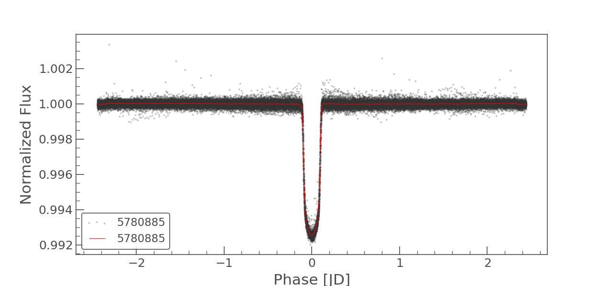
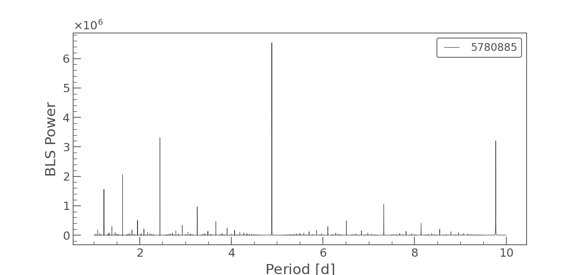
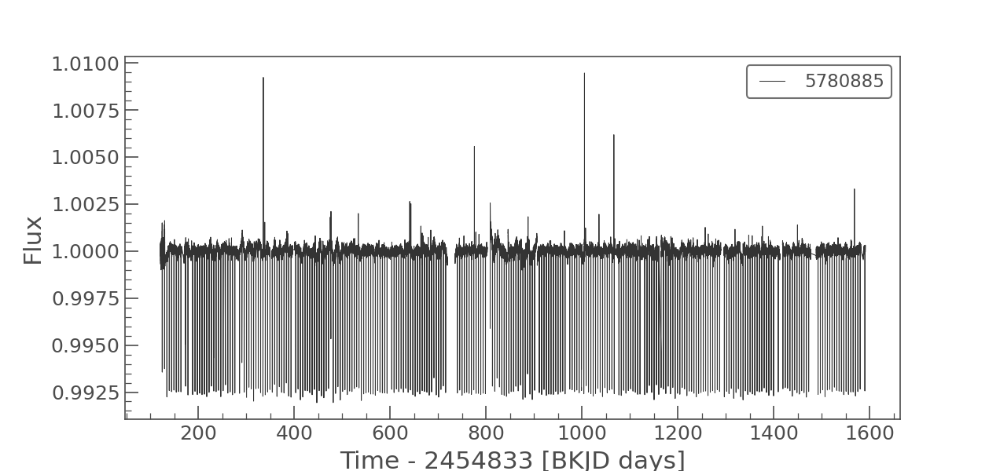
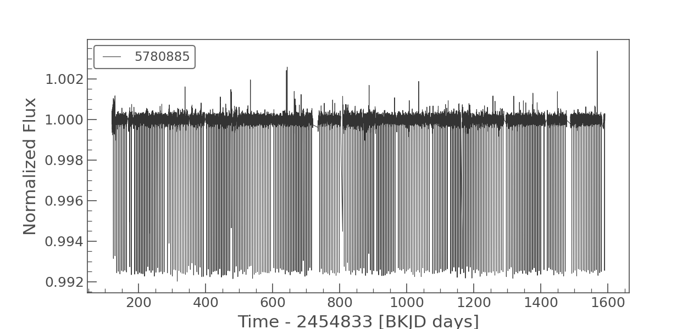

# kepler7b-transit-detection
Detects the exoplanet Kepler-7b in real NASA Kepler telescope data. The planet blocks a tiny fraction of its star's light every 4.885 days, and this Python project finds that repeating dip using a Box Least Squares (BLS) search, then estimates the planet's size. Built with lightkurve.

## About Kepler-7b

Kepler-7b is a low-density "hot Jupiter" orbiting a star about 3,000 light-years away. It circles its star every 4.885 days and blocks about 0.6% of the starlight as it passes in front, which makes it an ideal first target for transit detection.

## How it works

1. Load the stitched Kepler long-cadence light curve (or download it from MAST)
2. Clean it: remove NaNs, flatten slow drifts, clip upper outliers only (keeps the transits)
3. Run a two-stage BLS period search (coarse, then fine)
4. Fold the light curve on the best period
5. Estimate the planet radius from the transit depth
## Results

### Folded transit

### BLS periodogram

### Raw vs. cleaned light curve

